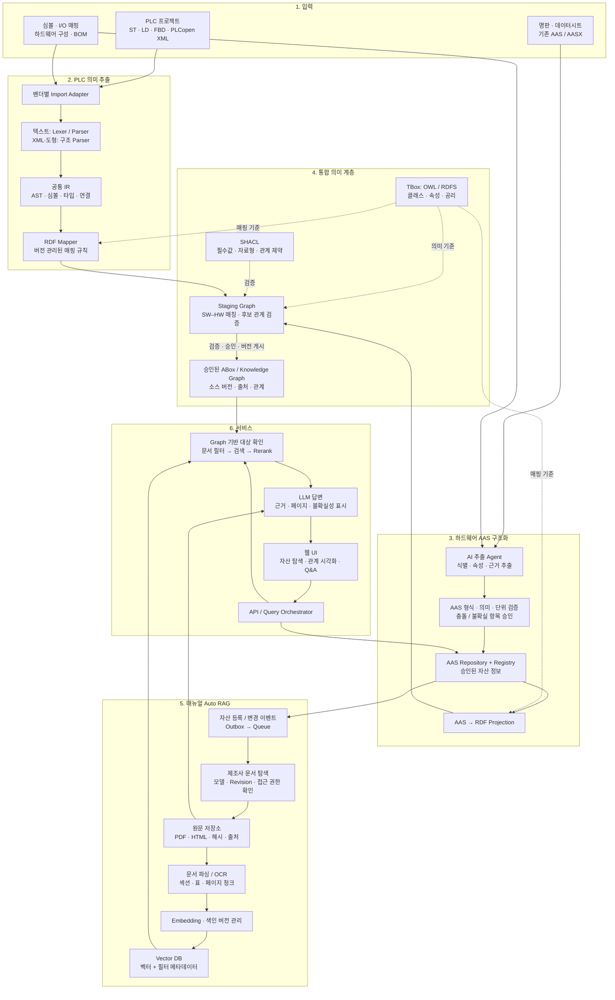
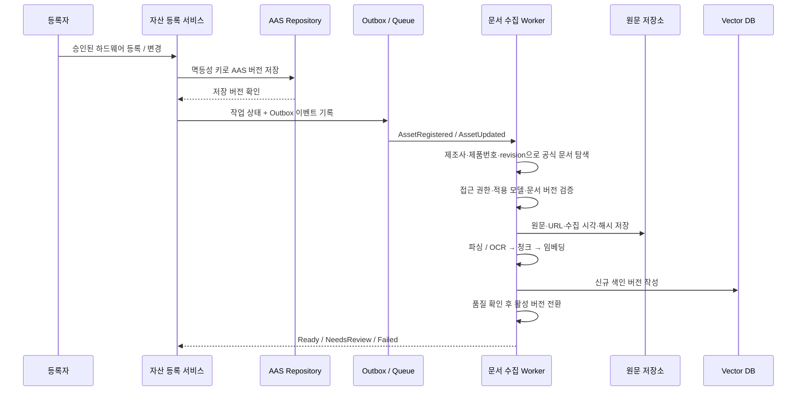

# PLC · AAS · 온톨로지 · Auto RAG 통합 아키텍처

> 설계 제안 문서입니다. 아래 구성 요소와 검증 기준은 구현 완료 상태가 아니라 권장하는 목표 구조입니다.
>
> **목표:** PLC 프로그램의 의미, 실제 설비의 구성, 제조사 매뉴얼의 근거를 연결하여 “어떤 로직이 어떤 장치를 사용하며, 관련 사양과 조치 방법은 무엇인가?”에 답하는 시스템을 구축합니다.

## 1. 한눈에 보는 구조

```text
 PLC 프로젝트                         하드웨어 자료
 소스 · 심볼 · I/O 설정                BOM · 명판 · 사양서 · AASX
          │                                   │
          ▼                                   ▼
 Parser → 공통 IR                     AI 추출 → 검증 · 승인
          │                                   │
          ▼                                   ▼
 RDF Mapper                           AAS Repository
          │                                   │
          │                            AAS → RDF Projection
          │                                   │
          └───────────────┬───────────────────┘
                          ▼
              통합 지식 그래프: ABox
              로직 ↔ 변수 ↔ I/O ↔ 장치
                          ▲
                 TBox + SHACL
              용어 · 관계 · 검증 규칙

 승인된 하드웨어 등록 / 변경
          │
          ▼
 제조사 매뉴얼 탐색 → 모델 · 버전 확인 → 수집 → 파싱 / OCR
          │
          ▼
 원문 저장 → 청크 · 메타데이터 → 임베딩 → Vector DB
          │                                    │
          └──── 문서 ID · 페이지로 추적 ────────┘

 사용자 질문
     → 지식 그래프로 대상 장치 · 적용 문서 범위 확인
     → Vector DB에서 근거 검색
     → 근거 기반 답변 + PLC 위치 + AAS 링크 + 매뉴얼 페이지
```

**핵심은 세 경로의 합류입니다.**

| 경로 | 입력 | 결과 | 주된 책임 |
|---|---|---|---|
| SW 의미화 | PLC 프로젝트 | 프로그램·변수·I/O 관계 그래프 | 결정론적 Parser와 Mapper |
| HW 구조화 | 장치 식별 정보와 기술 자료 | 표준화된 AAS와 장치 관계 | AI 추출 + 규칙 검증 + 승인 |
| 문서 지식화 | 승인된 장치의 제조사 문서 | 검색 가능한 근거 문서 | 이벤트 기반 Auto RAG |

## 2. 전체 아키텍처 다이어그램

Mermaid를 지원하는 Markdown 뷰어에서 아래 다이어그램을 볼 수 있습니다.



**데이터 계층별 역할**

| 저장소 | 보관하는 것 | 보관하지 않거나 주의할 것 |
|---|---|---|
| AAS Repository | 자산 ID, 식별 정보, 기술 특성, 서브모델 | LLM이 추측한 값을 확정 사양으로 저장하지 않음 |
| RDF Triple Store | SW–HW 관계, 온톨로지, 출처와 버전 | 대용량 원문이나 매 스캔의 PLC 값을 직접 적재하지 않음 |
| Vector DB | 청크 임베딩과 검색용 메타데이터 | 설비 구성과 사양의 원장으로 사용하지 않음 |
| Object Storage | 수집 원문, PLC 원본, AASX, 추출 산출물 | 원문과 추출 결과의 버전을 혼동하지 않음 |
| PostgreSQL | 작업 상태, 승인 이력, 식별자 매핑, 이벤트 Outbox | AAS 필드를 독립적으로 중복 수정하지 않음 |

## 3. `Lexer → Parser → RDF Mapper → TBox → ABox`의 정리

구상하신 흐름은 다음과 같이 조정하는 것이 정확합니다.

```text
                         TBox: 무엇을 어떤 관계로 표현할 것인가?
                           │
                           ▼
 입력 → Parser → 공통 IR → RDF Mapper → 후보 ABox → 검증 → 승인된 ABox
          ▲                                      ▲
    ST는 Lexer 사용                           SHACL 제약
    LD/FBD/XML은 구조 파싱
```

- **TBox:** `Device`, `IOChannel`, `Variable`, `Program`, `FunctionBlock` 등의 개념과 관계를 정의합니다. 먼저 최소 스키마를 설계하고 이후 버전 관리합니다.
- **ABox:** 실제 프로젝트의 `Motor_01`, `DO_Channel_03`, `StartCommand` 같은 개체와 사실을 저장합니다.
- **RDF Mapper:** IR의 구조를 TBox 어휘에 맞는 RDF 트리플로 변환합니다.
- **SHACL:** 필수 식별자, 자료형, 관계의 대상 타입, 유일성 정책 등을 검증합니다. OWL 추론만으로 입력 검증을 대체하지 않습니다.
- **Reasoning:** MVP는 명시적 관계와 제한된 규칙부터 적용합니다. 전체 OWL 추론을 처음부터 필수 경로로 넣지 않습니다.

ST 텍스트 파싱과 LD/FBD의 그래픽 네트워크 파싱은 다릅니다. PLCopen XML 내 ST 본문은 다시 텍스트 파싱하고, 그래픽 네트워크는 노드·포트·연결을 읽어 같은 IR로 정규화합니다. 벤더 확장 정보와 원본 위치도 보존합니다.

### 공통 IR에 필요한 최소 정보

| 범주 | 예 |
|---|---|
| 소스 추적 | 프로젝트 ID, revision, 파일, POU, 줄 또는 네트워크/요소 ID |
| 프로그램 | POU, Program, FunctionBlock, Function, Task, 호출 관계 |
| 심볼 | 변수명, 네임스페이스, 자료형, 스코프, 선언과 참조 |
| 로직 관계 | 읽기/쓰기, FB 호출, 명시적 데이터 흐름 |
| I/O | 원본 주소, 정규화 주소, 컨트롤러, 랙/슬롯/채널 |

단순 변수 참조와 실제 제어·인과 관계는 구분합니다. 코드만으로 장치의 물리적 배선이나 인터록 안전성을 확정할 수 없습니다.

## 4. 하드웨어 데이터 → AI Agent → AAS

### 권장 처리 순서

1. **기존 AAS 우선 수용:** 제조사가 AAS/AASX를 제공하면 버전과 형식을 검증하여 재사용합니다.
2. **장치 식별:** 제조사, 제품번호, 모델, 하드웨어 revision, 시리얼, 설치 위치를 분리합니다.
3. **근거 추출:** 명판·BOM·사양서에서 필드별 값과 출처 페이지를 추출합니다.
4. **템플릿 매핑:** 적합한 IDTA 서브모델 템플릿을 검토하고, 식별 정보·기술 데이터·문서 정보를 구조화합니다.
5. **검증:** AAS 메타모델/스키마, 템플릿 제약, 단위, 범위, 기존 등록 정보와의 충돌을 확인합니다.
6. **승인:** 신규 매핑과 불확실·충돌 항목은 사람이 확인합니다. 미확인 필드는 “미확인”으로 남깁니다.
7. **등록과 투영:** 승인된 버전을 AAS Repository에 저장하고 RDF와 문서 수집 작업을 갱신합니다.

### AAS 설계 원칙

- **제품 타입과 설치 개체를 분리:** 동일 모델 장치 20대는 제품 사양을 공유하더라도 시리얼·설치 위치·배선은 각각 다릅니다. 타입 AAS와 인스턴스 AAS의 사용 정책을 정합니다.
- **`semanticId` 활용:** 서브모델/속성이 나타내는 의미를 식별합니다. 적용 가능한 ECLASS, IEC CDD, IDTA 정의 등을 사용하고 사내 개념은 관리되는 URI로 정의합니다.
- **식별자 혼동 금지:** AAS ID, 자산 `globalAssetId`, 시리얼, 제품번호, `idShort`는 서로 다른 역할입니다. `idShort`를 전역 식별자로 사용하지 않습니다.
- **AAS는 교환 모델, TBox는 도메인 의미 모델:** AAS의 RDF 표현을 이용해도 “이 출력 변수가 이 장치를 제어한다”라는 PLC 도메인 관계까지 자동 생성되지는 않습니다.
- **단방향 투영부터 시작:** AAS의 승인된 HW 필드를 그래프로 투영합니다. 그래프 수정으로 AAS를 임의로 덮어쓰는 양방향 동기화는 MVP에서 제외합니다.

Agent는 자율적으로 사양을 “완성”하는 역할이 아니라 **근거를 수집하고 구조화 후보를 제시하는 역할**입니다. `필드 값 + 출처 + 추출 방법 + 검증 상태`를 함께 관리합니다.

## 5. SW–HW를 연결하는 핵심: Identity & Binding

```text
Program
  └─ hasVariable → StartCommand
                      └─ mappedTo → PLC_A / Rack_0 / Slot_2 / Channel_3
                                         └─ connectedTo → Contactor_K1
                                                              └─ actuates → Motor_01
                                                                              ├─ representedBy → AAS
                                                                              └─ hasProductType → ProductType
                                                                                                     └─ documentedBy → Manual
```

위 관계 이름은 **사내 도메인 온톨로지 예시**이며 AAS 표준 속성 이름이 아닙니다.

| 연결 | 우선 근거 | 주의점 |
|---|---|---|
| 변수 ↔ I/O 채널 | PLC 심볼과 I/O 설정 | `%QX0.3` 같은 주소만으로 전역 식별 불가 |
| 채널 ↔ 물리 장치 | 전장 설계, 배선표, 승인된 I/O List | BOM만으로 실제 배선 확정 불가 |
| 장치 ↔ AAS | 승인된 asset ID 매핑 | 모델명이 같아도 다른 설치 개체 |
| 장치 ↔ 제품 타입 | 제조사 + 제품번호 + revision | 문자열 유사도만으로 확정 금지 |
| 제품 타입 ↔ 매뉴얼 | 공식 적용 모델 목록과 revision | 제품군 문서는 적용 범위를 별도 기록 |

**권장 ID 정책:** 프로젝트·자산·제품 타입·문서는 이름과 분리된 안정 ID를 사용합니다. I/O는 컨트롤러 범위와 구성 revision을 함께 기록하고, 주소 변경 전후의 대응 관계를 관리합니다.

각 연결에는 `source`, `sourceRevision`, `mappingRuleVersion`, `reviewStatus`를 기록합니다. 자동 추정은 후보 그래프에만 저장하며 승인 전에는 확정된 제어 관계로 답변하지 않습니다.

### 이 구조로 답할 수 있는 질문

> “Motor_01이 기동하지 않을 때 어디부터 확인해야 하나?”

1. 그래프에서 Motor_01의 접촉기·I/O·출력 변수·관련 POU를 찾습니다.
2. AAS에서 해당 장치의 정확한 제품번호와 revision을 확인합니다.
3. 그 제품에 적용되는 승인된 매뉴얼에서 기동 조건·고장 진단 항목을 검색합니다.
4. PLC 소스 위치와 매뉴얼 페이지를 함께 제시합니다.

실제 운전 상태까지 판단하려면 별도의 텔레메트리가 필요합니다. 정적 코드와 매뉴얼만으로 현재 고장 원인을 단정하지 않습니다.

## 6. 등록 기반 매뉴얼 Auto RAG

여기서 Auto RAG는 **자산 변경에 반응하는 자동 문서 수집·색인 파이프라인**을 뜻합니다. 특정 제품이나 라이브러리를 전제로 하지 않습니다.



### 수집 정책

- 제조사 공식 사이트와 승인된 제공처를 우선하고, API·공식 다운로드 카탈로그가 있으면 먼저 사용합니다.
- 이용약관·저작권·라이선스·접근 권한·요청 제한을 확인합니다. `robots.txt` 허용만으로 수집 권한을 가정하지 않습니다.
- 로그인 우회나 무제한 크롤링을 하지 않습니다. 권한이 불명확하면 수동 업로드 또는 검토 대기로 전환합니다.
- 모델·문서 revision·언어·적용 펌웨어를 확인합니다. 제품군 매뉴얼은 해당 모델이 포함됨을 검증합니다.
- 검색 결과 부재, 다운로드 차단, OCR 실패를 명시적 상태로 남기고 운영자에게 알립니다. 관련 없는 문서로 대체하지 않습니다.

### 청크와 검색 정책

| 항목 | 권장 설계 |
|---|---|
| 청크 단위 | 제목/절/표 기준 분할, 실제 페이지와 표 헤더 보존 |
| 필수 메타데이터 | `documentId`, `productTypeId`, `manufacturer`, `model`, `revision`, `language`, `page`, `section`, `sourceUrl`, `contentHash`, `acl`, `indexVersion` |
| 검색 순서 | 사용자 권한 → 그래프의 적용 문서 ID → 메타데이터 필터 → 벡터/키워드 검색 → Reranker |
| 검색 방식 | 의미 검색과 정확한 모델명·에러 코드 검색을 결합; 키워드 검색은 sparse 색인 또는 별도 검색엔진 사용 |
| 인용 | 문서명·버전·페이지·원문 위치를 출력; 인용은 검색된 청크에 실제 포함되어야 함 |
| 답변 보류 | 적용 문서가 없거나 근거가 부족하면 명시적으로 보류; 필터를 조용히 완화하지 않음 |
| 중복 제거 | 문서 해시 + 청크 ID + 색인 버전으로 멱등 처리 |
| 갱신 | 신규 버전 검증 후 전환, 이전 버전은 이력 보존 및 검색에서 제외 |

Vector DB 청크를 모두 RDF 트리플로 복제할 필요는 없습니다. 그래프는 **문서의 적용 대상과 관계**, Vector DB는 **문서 본문 검색**을 맡고 `documentId`로 연결합니다.

## 7. 권장 기술 스택

아래는 선택을 쉽게 하기 위한 **기본 조합**입니다. 모든 대안을 동시에 도입하지 않습니다.

| 계층 | 기본 추천 | 선택 이유 / 대안 |
|---|---|---|
| 웹 UI | React + TypeScript + Cytoscape.js | 자산 트리, 관계 그래프, 소스/매뉴얼 근거 패널 구성 |
| 서비스 API | FastAPI + Pydantic | 데이터 검증, 비동기 작업 API, AI 도구 연계 |
| PLC Parser | ST: ANTLR4, XML: 표준 XML Parser | ST 문법과 벤더 확장은 별도 확보·검증 필요; LD/FBD는 연결 구조를 IR로 변환 |
| 공통 IR | 버전 있는 JSON Schema | Parser와 RDF Mapper를 분리하고 회귀 테스트 가능 |
| RDF 생성 / 검증 | RDFLib + pySHACL | 트리플 생성, 매핑 테스트, 제약 검증 |
| 온톨로지 편집 | Protégé + OWL / RDFS + SHACL | 용어·관계·입력 제약을 명시적으로 관리 |
| Triple Store | Apache Jena Fuseki | SPARQL 기반 관계 검색; 추후 규모와 운영 요구에 따라 대안 평가 |
| AAS 인프라 | Eclipse BaSyx Repository / Registry | AAS·서브모델 저장과 서비스 검색; 채택한 사양 버전과 API 호환성 확인 |
| AI Agent 흐름 | LangGraph + 구조화 출력 가능한 LLM | 추출·도구 호출·검토 상태 흐름; 단순 MVP는 일반 작업 코드로도 충분 |
| 문서 파싱 | Docling, OCR 필요 시 PaddleOCR | 표·레이아웃 추출 후보; 실제 한글·영문 매뉴얼로 품질 평가 후 확정 |
| RAG 구성 | LangChain 또는 직접 구현 | 검색·재정렬·인용 조립; Agent 프레임워크와 역할 분리 |
| Vector DB | Qdrant | 벡터 검색과 payload 필터; 작은 MVP는 PostgreSQL + pgvector도 가능 |
| Embedding / Reranker | BGE-M3 + 다국어 reranker 후보 | 한국어·영어·모델명 혼합 질의로 비교 평가; 모델 라이선스와 배포 환경 확인 |
| 원문 저장 | S3 호환 Object Storage | 원문·추출본·해시·버전 보관; 개발 환경은 접근 제어된 로컬 저장소 가능 |
| 운영 상태 / 승인 | PostgreSQL | 작업 이력, 승인, 식별자 바인딩, Outbox |
| 비동기 작업 | Celery + Redis | 수집·OCR·임베딩 재시도; 장기 워크플로 요구가 커지면 Temporal 검토 |
| 인증 / 관측 | OIDC, OpenTelemetry, 중앙 로그 | 사용자·문서 권한, 요청 추적, 작업 실패 및 검색 품질 관측 |
| 배포 | Docker Compose로 시작 | 분산 운영 요구가 생기기 전 Kubernetes 도입을 필수화하지 않음 |

**초기 개발 언어 구성:** 데이터·AI 계층은 Python, 웹은 TypeScript로 통일하고 AAS와 Triple Store는 독립 서비스로 사용합니다. 구체적인 버전은 착수 시 호환성을 검증한 조합으로 고정합니다.

LLM과 임베딩은 보안 정책에 따라 내부 배포 또는 승인된 서비스를 선택합니다. PLC 소스·설비 정보·비공개 매뉴얼을 외부 모델로 무조건 전송하지 않습니다.

## 8. 동기화·운영에서 빠뜨리면 안 되는 부분

### 원장과 버전

- PLC 정보 원장은 **버전 관리된 PLC 프로젝트**, HW 정보 원장은 **승인된 AAS**, 문서 원장은 **원문과 수집 메타데이터**입니다.
- 그래프와 Vector DB는 재생성 가능한 파생 데이터로 취급합니다.
- `sourceRevision`, `ontologyVersion`, `mappingRuleVersion`, `aasVersion`, `indexVersion`을 기록합니다.
- 승인된 스냅샷의 구성 버전을 묶어 관리합니다. 질의 시 서로 다른 시점의 PLC·배선·AAS가 섞였으면 경고하거나 답변을 제한합니다.

### 실패와 재처리

- AAS Repository와 업무 DB는 일반적으로 단일 트랜잭션이 아닙니다. Outbox만으로 두 저장소의 원자성이 생기지 않습니다.
- 등록 서비스는 저장 단계와 대상 버전을 기록하고, 멱등 저장·재시도·주기적 대사로 “AAS만 저장되고 이벤트가 누락된 경우”를 복구합니다.
- 이벤트는 중복 수신을 전제로 설계합니다. `eventId`와 대상 버전으로 멱등 처리하고, 늦게 도착한 이벤트가 최신 색인을 덮어쓰지 않게 합니다.
- AAS 원문은 승인됐지만 RDF 투영 검증이 실패하면 해당 버전을 그래프에 게시하지 않고 작업 상태와 불일치를 표시합니다.
- 삭제·문서 철회·자산 폐기 시에는 그래프 관계, 검색 색인, 캐시까지 비활성화합니다.

### 보안과 제어 경계

- 이 시스템은 초기에는 **읽기 전용 엔지니어링 지원 시스템**입니다. Agent나 RAG 답변을 PLC 쓰기·제어 경로에 연결하지 않습니다.
- 웹 수집기는 허용 도메인·네트워크 정책을 적용하고 사설망 주소 접근을 차단합니다. 파일 크기·유형 제한, 악성 파일 검사와 격리된 문서 처리를 적용합니다.
- 매뉴얼 내부의 명령문은 신뢰하지 않는 데이터입니다. 문서의 프롬프트 인젝션이 Agent의 도구 권한을 바꾸지 못하게 합니다.
- 사용자 권한은 UI뿐 아니라 AAS 조회, 그래프 조회, 문서·청크 검색, 원문 다운로드에 모두 적용합니다.

### 실시간 데이터는 별도 경로

나중에 운전 상태를 연결하려면 `OPC UA / MQTT → 시계열 저장소 → 자산 ID 연결` 경로를 추가합니다. 온톨로지는 값의 의미·단위·연결을 설명하고, 고빈도 값은 시계열 저장소가 맡습니다. 정적 분석 결과를 실시간 상태로 표현하지 않습니다.

## 9. MVP 범위와 검증 기준

### 권장 구현 순서

| 단계 | 범위 | 확인할 산출물 |
|---|---|---|
| 1. 의미 모델 | PLC 벤더 1종, 대표 프로젝트, 장치군 1종 선정 | 최소 TBox, SHACL, ID 정책, IR 스키마 |
| 2. SW 파이프라인 | 선언·타입·읽기/쓰기·I/O 추출 | PLC 원본 위치까지 추적되는 ABox |
| 3. HW 연계 | 소수 자산의 AAS 등록, 승인된 배선 연결 | 변수 → 채널 → 장치 → AAS 조회 |
| 4. 문서 자동화 | 승인 제조사 1곳, 대표 매뉴얼 수집 | 이벤트 → 원문 → 색인 → 재처리 |
| 5. 통합 질의 | 자산 선택형 Q&A부터 구현 | 정확한 모델의 근거와 페이지를 가진 답변 |
| 6. 확대 | 벤더·장치군·다국어·실시간 연계 | 호환성 테스트와 운영 관측 지표 |

### 초기 수용 기준 제안

아래 수치는 확정 성능이 아니라 **대표 샘플을 정한 후 합의할 목표 기준**입니다.

| 검증 항목 | 방법 / 목표 |
|---|---|
| Parser 정확성 | 지원 문법의 고정 테스트에서 선언·타입·주소·참조 기대 결과 100% 일치; 미지원 구문은 오류와 위치 보고 |
| RDF 검증 | 승인 게시 대상의 필수 SHACL 제약 위반 0건 |
| SW–HW 오연결 | 사람이 확정한 기준 바인딩 집합에서 오연결 0건; 미확정 연결은 후보로 남김 |
| AI 추출 | 필드별 근거 존재율 100%; 정확도는 모델/필드별 별도 측정하며 중요 사양은 승인 |
| 매뉴얼 적용성 | 승인 문서 집합에서 다른 모델·revision의 문서가 검색 범위에 섞이는 경우 0건 |
| 검색 품질 | 전문가 라벨 질의 50개 이상에서 Recall@5 90% 이상을 초기 목표로 평가 |
| 인용 품질 | 평가 답변의 사양·절차 주장마다 실제 근거 청크와 페이지 존재 |
| 답변 보류 | 미등록 장치·잘못된 revision·근거 부족 테스트에서 근거 없는 확정 답변 0건 |
| 재처리 | 동일 이벤트 반복 시 중복 자산·문서·청크 생성 0건 |
| 변경 / 권한 | 철회 문서·구버전·권한 없는 문서는 검색 및 원문 조회에서 제외 |

## 10. 설계 근거와 공식 참고 자료

배경지식 없이 항목별로 학습하려면 [한국어 스터디 로드맵](study/README.md)을 참고하십시오. 공통 기초부터 AAS 사양·메타모델·BaSyx·OWL·SHACL까지 PLC 예제, 실습, 복습 문제와 해답을 제공합니다.

- [IDTA AAS Specifications](https://industrialdigitaltwin.org/en/content-hub/aasspecifications): 메타모델, API, 데이터 사양, 교환 형식 등 관련 사양의 진입점입니다.
- [AAS Metamodel Part 1, v3.1](https://industrialdigitaltwin.io/aas-specifications/IDTA-01001/v3.1/index.html): 본 문서에서 참고한 메타모델 판본입니다. 구현 시 서버·SDK·서브모델 템플릿과 함께 지원 버전을 확인해야 합니다. AAS 교환 형식에는 RDF도 있으므로 별도 임의 형식부터 만들지 않고 공식 매핑의 재사용 가능성을 검토합니다.
- [Eclipse BaSyx Documentation](https://wiki.basyx.org/en/latest/): AAS 인프라와 SDK 구성의 공식 문서입니다.
- [W3C OWL 2 Primer](https://www.w3.org/TR/owl2-primer/): 클래스, 속성, 개체와 온톨로지 의미 모델의 근거입니다.
- [W3C SHACL](https://www.w3.org/TR/shacl/): RDF 데이터 그래프의 제약 검증 표준입니다.
- [Qdrant Filtering](https://qdrant.tech/documentation/search/filtering/): 모델·버전·문서·권한 관련 payload 필터 설계 시 참고할 수 있습니다.

---

**한 문장 요약:** PLC는 결정론적으로 의미를 추출하고, HW는 근거 기반 AI 추출과 검증으로 AAS화하며, 두 정보를 지식 그래프로 연결한 뒤 정확한 장치에 적용되는 매뉴얼만 Auto RAG로 검색하는 구조입니다.

## 11. 확장 리서치: 기존 그래프를 GNN에 활용하는 방법

> 조사일: 2026-11-02. 아래는 공개 논문·공식 문서에서 확인한 기법과 본 아키텍처에 대한 설계 제안을 구분한 내용입니다. 해당 PLC 시스템에 대한 성능을 실증한 결과는 아닙니다.

### 11.1 결론: 가능하지만 RDF 저장소 자체가 GNN은 아닙니다

기존 온톨로지 그래프는 **GNN의 구조적 사전 지식**으로 활용할 수 있습니다. 그래프를 없애거나 GNN으로 대체하는 것이 아니라, 승인된 그래프에서 학습용 표현을 만들어 별도 모델에 입력합니다.

```text
승인된 ABox + AAS 속성 ──→ 그래프 학습용 Projection ──→ 노드/관계/정적 특성
                                                            │
시계열 DB ──→ 시간 정렬 · 품질 마스크 · 운전 모드 ──→ 구간별 동적 특성
                                                            │
                                                            ▼
                                                   GNN / 시공간 모델
                                                            │
                                             이상 점수 · 관련 신호 · 후보 순위
                                                            │
                                             검토용 분석 결과 + Agent 도구
```

TBox는 노드·관계 타입을 정하고 불가능한 후보 관계를 제한하는 데 사용합니다. 학습 메시지 전달의 주 대상은 ABox의 실제 장치·신호·프로그램입니다. 모든 OWL 공리와 문서 청크를 무조건 학습 그래프에 넣을 필요는 없습니다.

### 11.2 적용 기능과 우선순위

| 응용 | 모델이 학습하는 것 | 필요한 데이터 | 권장 수준 |
|---|---|---|---|
| 관계 기반 이상 탐지 | 함께 반응해야 할 신호들의 정상 패턴과 이탈 | 정상 운전 구간, 연결 관계, 운전 모드 | 시계열 확보 후 우선 실험 |
| 고장 관련 신호 순위화 | 이상 구간에서 유력한 장치·신호 후보 | 고장·정비 이력과 확인된 원인 라벨 | 진단 보조; 원인 확정 아님 |
| 누락 관계 후보 추천 | 변수–채널–장치 간 가능한 연결 | 충분한 승인 관계와 검증용 표본 | 수동 승인 조건으로 실험 |
| 유사 설비/운전 구간 검색 | 구조와 동작이 유사한 임베딩 | 반복 설비 또는 충분한 운전 사례 | 규칙·일반 임베딩 검색과 비교 |
| 고장 전조/잔여수명 | 고장까지의 상태 변화 | 열화·고장 이력, 운전 부하와 정비 기록 | 정적 그래프만으로 구현 불가 |

기존 그래프 탐색만으로 해결되는 “어떤 I/O에 연결됐는가?”에는 SPARQL이 더 직접적입니다. **GraphRAG는 그래프를 이용한 검색 방식이고 GNN은 학습 모델이므로 서로 필수가 아닙니다.**

### 11.3 논문·프레임워크에서 확인되는 적용 근거

| 자료 | 확인된 핵심 | 본 시스템에 적용할 아이디어 / 한계 |
|---|---|---|
| [GDN, Graph Neural Network-Based Anomaly Detection in Multivariate Time Series](https://arxiv.org/abs/2106.06947) | 센서 관계를 학습하고 그래프 attention으로 예측하여 관계 이탈을 탐지; 수처리 데이터 실험 | 명령–피드백–전류 관계 이상 탐지의 비교 기준. 원 논문은 관계를 학습하는 방식이며 온톨로지 기반 구조를 결합하는 것은 별도 확장 |
| [MTAD-GAT](https://arxiv.org/abs/2009.02040) | 변수 간·시간 간 관계를 모델링하는 다변량 시계열 이상 탐지 | 다신호 구간 분석의 비교 기준. PLC 물리 구조나 이기종 AAS 그래프가 자동으로 반영되는 모델은 아님 |
| [R-GCN](https://arxiv.org/abs/1703.06103) | 관계 타입별 메시지 전달을 통한 관계 데이터 표현 학습 | `mappedTo`, `connectedTo`, `reads`, `writes`를 구분. 링크 추천은 디코더·학습 목적·검증 설계를 추가해야 함 |
| [GraphSAGE](https://arxiv.org/abs/1706.02216) | 이웃 특성을 집계하는 inductive 표현 학습 | 새 장치도 학습 당시와 호환되는 타입·특성·이웃이 있으면 적용 후보. 새로운 종류의 장치나 관계로 자동 일반화된다는 보장은 없음 |
| [PyG Heterogeneous Graph Learning](https://pytorch-geometric.readthedocs.io/en/latest/notes/heterogeneous.html) | `HeteroData`로 노드·관계 타입별 텐서와 모델 구성 지원 | 장치·신호·POU 타입을 유지한 학습용 그래프 구현에 적합 |

### 11.4 RDF → 학습용 그래프 변환 설계

| RDF/AAS 정보 | 학습용 표현 | 주의사항 |
|---|---|---|
| 실제 장치, 신호, POU | 타입별 노드 ID | 원래 URI와 학습용 정수 ID의 대응표 유지 |
| `Signal mappedTo IOChannel` 등 | 타입별 `edge_index` | 방향 유지; 역방향 메시지 전달은 별도 관계로 명시 |
| 정격 전류, 단위, 장치 역할 | 수치/범주형 정적 특성 | 단위 정규화, 결측 마스크; 정격 값과 실측 값을 분리 |
| 시계열 구간 | 신호별 시간 특성 | Boolean·아날로그·카운터를 구분; 운전 모드 포함 |
| 승인 상태와 근거 | 필터·품질 특성 | 미확정 배선을 확정 정답처럼 사용하지 않음 |
| 문서 내용 | 필요 시 문서 임베딩 | 전체 청크 그래프는 MVP에서 제외; 사양 추출부터 시작 |

RDF의 literal은 대체로 특성으로, 개체 간 관계는 edge로 변환합니다. 하나의 개체가 여러 RDF 타입을 가질 수 있으므로 학습용 주 타입/다중 타입 정책을 정합니다. Blank node도 재현 가능한 식별 규칙이 필요합니다.

**권장 초기 구성**

- **정적 관계 과제:** 이기종 GraphSAGE 계열 또는 R-GCN 기반 모델 + 관계 후보 디코더.
- **동적 이상 탐지:** 신호별 시간 인코더(TCN/GRU 등) + 관계별 메시지 전달 + 다음 값/구간 예측.
- 개념적으로 `z_i(t) = TemporalEncoder(과거 구간, 품질 마스크, 운전 모드)`, 이후 `GNN(정적 특성, z(t), 승인된 관계)`로 이상 점수를 만듭니다.
- 처음에는 **고정 토폴로지 + 변하는 신호 값**으로 충분합니다. 값이 실시간으로 바뀐다는 이유만으로 temporal-edge GNN이 필요한 것은 아닙니다. 배선·설비 구성이 바뀌면 유효 시점에 맞는 그래프 버전을 선택합니다.
- 데이터에서 추가 학습한 상관 edge는 물리적 배선 edge와 타입을 분리하고 승인 그래프를 덮어쓰지 않습니다.
- 노드별 학습 ID 임베딩에만 의존하면 새 장치에 취약합니다. 정격·역할·단위 등 재사용 가능한 특성을 우선합니다.

### 11.5 학습·평가에서 반드시 지킬 경계

- **원인과 상관의 구분:** 높은 anomaly/attention 점수는 조사 후보입니다. 인과 확정에는 공정 지식, 시간 선후, 개입·정비 증거 등이 추가로 필요합니다.
- **Open-world:** RDF에 관계가 없다고 거짓 관계는 아닙니다. 링크 학습의 음성 표본은 타입·물리 제약으로 구성하고 미확인 관계의 오라벨링을 평가합니다.
- **누출 방지:** 겹치는 시계열 윈도우를 무작위로 나누지 않습니다. 원시 시간축을 먼저 분리하고 윈도우·예측 범위가 경계를 넘지 않게 합니다. 정규화·상관 그래프 학습·임계값 튜닝은 학습/검증 구간에서만 수행합니다.
- **링크 평가:** 정답 edge와 그 역관계·중복 표현을 학습 그래프에서 제거합니다. 신규 설비 성능은 설비 단위 holdout으로 따로 평가합니다.
- **운영 평가:** 오경보/시간, 탐지 지연, 이벤트 단위 precision/recall, 원인 후보 Recall@k를 측정합니다. 한 점을 맞췄다고 이상 구간 전체를 정답 처리하는 지표만 보고하지 않습니다.
- **비교군:** 임계값·타이머 규칙, 단일 신호 모델, GNN 없는 시간 모델과 비교합니다. 그래프 제거 실험으로 관계 정보의 실제 기여를 확인합니다.
- **안전:** 예측 관계·이상 점수는 별도 분석 결과로 저장하며 자동 PLC 제어 또는 안전 판단에 사용하지 않습니다.

## 12. 확장 리서치: 시간 구간을 Agent의 맥락으로 제공하는 방법

### 12.1 결론: 가능합니다. 핵심은 Temporal Context Builder입니다

사람도 historian의 추세 그래프와 이벤트 이력으로 구간을 볼 수 있습니다. Agent에는 같은 데이터를 **기계가 해석하기 좋은 구조**로 제공하면 됩니다.

단, 범용 텍스트 LLM에 원시 숫자를 모두 붙이는 것과 시간 패턴을 이해시키는 것은 다릅니다. 구간 계산은 시계열 도구가 수행하고, Agent는 결과와 근거를 종합하도록 분리하는 것이 안전합니다.

```text
PLC / Edge Collector
        │  값 + 시간 + 품질 + 수집 조건
        ▼
Time-series DB ──→ 구간 조회 · 상태 전이 · 통계 · 이상 분석
        │                              │
        │         Knowledge Graph ─────┤ 대상 신호 · 연결 · 의미
        │         AAS / Recipes ───────┤ 정격 · 운전 조건
        │                              ▼
        │                    Temporal Context Builder
        │                    요약 + 사건 순서 + 원본 참조
        │                              │
        └── 필요 구간 재조회 도구 ←── Agent ←── 매뉴얼 RAG
                                       │
                               근거 기반 설명 · 추가 조회
```

`Temporal Context Builder`, 아래 API 이름과 JSON은 **본 설계를 위한 제안**이며 정해진 표준 제품명/API는 아닙니다.

### 12.2 시간 구간의 맥락은 네 층으로 구성합니다

| 층 | 담을 정보 | 예 |
|---|---|---|
| 의미 맥락 | 신호 역할·단위·배선·프로그램·구성 버전 | StartCmd는 출력 명령, RunFb는 운전 피드백 |
| 운전 맥락 | 모드·레시피·공정 단계·부하·예상 지연 | 자동 모드에서 기동 피드백 제한 시간 500 ms |
| 시간 맥락 | 시작 상태·전이 순서·지속 시간·추세 | 명령 ON 후 500 ms 안에 피드백 없음 |
| 증거/품질 | 원본 범위·샘플링·결측·시계 오차·규칙 버전 | 수집 누락 여부, 관측 가능한 최소 펄스 조건 |

정격값만으로 정상 범위를 정하지 않습니다. 기동 중 전류와 정상 운전 중 전류는 다르고, 동일 지연도 공정 모드에 따라 정상 여부가 달라집니다.

### 12.3 먼저 확보해야 할 수집 데이터

- 최소 식별: `assetId`, `signalId`, `configurationVersion`, 타입, 단위.
- 값과 시간: 원천 시각, 서버/수집 시각, 가능한 경우 장치 sequence/scan ID. 원천 시각이 없으면 수집 시각과 구분하여 명시합니다.
- 품질: Good/Uncertain/Bad, 결측·중복·역순·queue overflow·연결 상태.
- 수집 조건: PLC scan 주기, 실제 승인된 sampling interval, publishing interval, deadband, queue 크기와 폐기 정책, timestamp 정밀도와 시계 동기 상태.

[OPC UA DataValue](https://reference.opcfoundation.org/Core/Part4/v105/docs/7.11)는 값뿐 아니라 StatusCode와 source/server timestamp를 정의합니다. [MonitoredItem 모델](https://reference.opcfoundation.org/Core/Part4/v105/docs/5.13.1)은 sampling·filter·queue·publishing을 구분합니다.

**중요:** source timestamp가 항상 모든 신호의 동일 scan 시각인 것은 아닙니다. timestamp 형식의 정밀도가 높아도 실제 측정·동기 정확도가 그만큼 높다는 뜻은 아닙니다.

20 ms 펄스를 100 ms 주기로 관측하면 펄스가 완전히 누락될 수 있습니다. 필요하면 PLC/Edge 측 전이 캡처·래치·이벤트 버퍼·scan 동기 로깅을 사용하고 실제 장비에서 검증합니다. 구독이나 change-only 저장을 사용한다고 모든 PLC 전이가 보존되는 것은 아닙니다.

### 12.4 신호 종류별 요약 전략

| 신호 | 보존할 내용 | 피해야 할 처리 |
|---|---|---|
| 디지털 I/O | 시작 상태, 상승/하강 edge, ON/OFF 지속 시간, 토글 수, 짧은 펄스 | 평균만 저장하여 전이 순서·펄스 소실 |
| 아날로그 | min/max와 시각, 시간 가중 평균, 변화율, 임계 초과 구간, 원시 파형 참조 | 변화 시에만 수집된 값에 단순 표본 평균 적용 |
| 카운터 | 증가량, reset/rollover, 정지 구간 | reset을 음의 생산량으로 해석 |
| 상태/알람 | 진입·해제, 지속 시간, 동시 발생, 운전 모드 | 서로 다른 상태 코드를 평균 |
| 복수 신호 | 명령→피드백 지연, 순서 위반, 동시성의 허용 오차 | 서로 다른 시계를 정밀한 인과 순서로 단정 |

[Timescale Toolkit의 state_agg](https://www.tigerdata.com/docs/reference/toolkit/state-tracking/state_agg)는 상태 전이·지속 시간·타임라인 계산을 지원합니다. [time_weight](https://www.tigerdata.com/docs/reference/toolkit/time_weight/time_weight)는 불규칙 표본의 시간 가중 계산에 활용할 수 있습니다. 실제 배포판의 Toolkit 지원 여부를 확인해야 합니다.

보간은 신호 의미에 맞게 선택합니다. Boolean은 선형 보간하지 않습니다. LOCF도 통신 단절이나 Bad 품질 구간까지 정상값으로 연장하지 않으며, 허용 최대 간격과 UNKNOWN 상태를 둡니다.

Change-only 방식은 구간 시작 직전의 마지막 유효값이 필요합니다. 그 값과 이후 구간의 수집 연속성을 확인할 수 없으면 시작 상태를 미확인으로 표시합니다. 구간 종료 시 OFF가 관측되지 않았으면 ON 지속 시간은 구간 내 하한일 수 있습니다.

### 12.5 Agent에 전달할 Context Package 예시

다음은 설명을 위한 **가상 데이터**입니다. 정상/이상 판단의 시간 한계도 가상의 승인 규칙입니다.

```json
{
  "schemaVersion": "1.0",
  "contextId": "ctx-demo-001",
  "assetId": "Motor_01",
  "window": {
    "start": "2026-11-02T06:00:00Z",
    "endExclusive": "2026-11-02T06:00:10Z"
  },
  "configurationVersion": "cfg-17",
  "operatingContext": {
    "mode": "AUTO",
    "phase": "STARTING",
    "expectedFeedbackMs": 500,
    "ruleRef": "approved-start-rule-v3"
  },
  "initialState": {
    "StartCmd": false,
    "RunFb": false
  },
  "events": [
    {
      "at": "2026-11-02T06:00:02Z",
      "signal": "StartCmd",
      "from": false,
      "to": true
    },
    {
      "at": "2026-11-02T06:00:02.500Z",
      "type": "feedback_timeout",
      "derived": true,
      "ruleRef": "approved-start-rule-v3"
    }
  ],
  "summary": {
    "RunFb": {
      "observedRisingEdges": 0,
      "stateDuringWindow": false
    }
  },
  "quality": {
    "source": "simulated_scan_trace",
    "scanIntervalMs": 10,
    "missingScans": 0,
    "scope": "scan_observations_only",
    "pulseCaptureBelowScanIntervalGuaranteed": false
  },
  "evidence": [
    {
      "ref": "trace-demo-001",
      "signals": ["StartCmd", "RunFb"],
      "kind": "raw_window"
    }
  ],
  "limitations": [
    "No analog current trace or physical inspection evidence"
  ]
}
```

이 예시에서 말할 수 있는 것은 “관측 구간에서 기동 명령 후 피드백이 관측되지 않았다”는 사실입니다. “모터 고장이 확정됐다”고 단정할 수는 없습니다.

### 12.6 토큰을 줄이면서 중요한 사건을 보존하는 조회 흐름

1. 사용자가 장치·시간 구간 또는 알람 ID를 지정합니다.
2. 그래프에서 관련 신호를 고릅니다. 제한된 hop과 관계 타입을 사용하되 필수 인터록·안전 관련 신호는 규칙으로 포함합니다.
3. 모드 전환·기동·알람 등 사건 경계를 중심으로 구간을 나눕니다. 알람 직전/직후와 정상 비교 구간을 함께 조회합니다.
4. 서버가 상태 전이·통계·품질을 계산하고, 허용 토큰 안의 Context Package를 구성합니다.
5. 생략된 신호·이벤트·구간과 잘림 여부를 명시합니다. 중요한 사건은 우선 포함하고 전체 이력은 원본 참조로 남깁니다.
6. Agent가 필요할 때 고해상도 부분 구간을 재조회합니다. 이후 적용 가능한 매뉴얼/로직 근거와 결합합니다.

제안 도구 계약:

- `get_temporal_context(asset_id, start, end, purpose, max_events)`: 의미·운전 상태·전이·요약·품질·원본 참조 반환.
- `get_signal_trace(signal_ids, start, end, resolution, page_token)`: 제한된 원시/집계 표본과 다음 페이지 반환.
- `compare_windows(asset_id, target_window, reference_window, mode)`: 같은 운전 조건의 차이와 비교 불가 항목 반환.

도구는 권한·최대 기간·최대 신호 수·표본 수를 제한합니다. 누락, 부분 응답, stale 상태는 구조화된 오류/상태로 반환하고 “정상”으로 처리하지 않습니다.

온라인 진단에서 미래 표본을 사용하지 않습니다. 알람 후 구간을 기다리면 `대기 중/부분 구간`을 표시하고, 사후 분석과 구분합니다. 지연 도착 데이터는 watermark/허용 지연 정책과 `asOf` 시각을 두어 결과를 버전 관리합니다.

### 12.7 장기 기억과 원시 시계열은 분리합니다

- **시계열 DB:** 재계산 가능한 원시 데이터와 다해상도 집계.
- **이벤트/에피소드 저장소:** 기동 실패·운전 사이클 등 의미 있는 시간 구간, 분석 버전, 근거 포인터.
- **Vector DB:** 필요 시 에피소드 설명의 임베딩으로 유사 사례 검색. 숫자의 정확한 비교는 시계열 도구가 수행.
- **지식 그래프:** 에피소드 ↔ 장치 ↔ 프로그램 ↔ 문서 ↔ 검증된 정비 결과의 관계.

LLM이 쓴 과거 요약을 원본 사실처럼 재사용하지 않습니다. 관측 사실·규칙 판정·모델 추정·사람이 확인한 결과를 별도 필드로 보존합니다.

## 13. 두 확장의 통합 및 추천 실행 순서

```text
온톨로지 / AAS ──→ 어떤 장치·신호이며 어떻게 연결되는가?
시계열 / 이벤트 ──→ 해당 구간에 무엇이 어떤 순서로 관측됐는가?
GNN / 시간 모델 ──→ 평소 관계에서 무엇이 벗어났는가?       [선택]
매뉴얼 RAG ──────→ 어떤 조건·제약·점검 근거가 있는가?
                          │
                          ▼
                Agent: 근거 통합 · 불확실성 · 추가 조회
```

**추천 순서는 Temporal Context → 규칙/기준 모델 → GNN입니다.** GNN 학습 데이터가 부족해도 구간 기반 Agent는 먼저 만들 수 있으며, 이 과정에서 고품질 학습·평가 데이터를 축적할 수 있습니다.

| 단계 | 구현 범위 | 검증 기준 |
|---|---|---|
| 1. 구간 관측 | 기동 명령·피드백·알람·전류와 수집 품질 확보 | 검증용 원본 trace의 전이·지속 시간·결측이 재현됨 |
| 2. Context Builder | 시작 상태, 사건 순서, 통계, 운전 맥락과 도구 API | 디지털 펄스·경계·Bad 품질·단절·지연 데이터 fixture 검증 |
| 3. Agent 진단 보조 | 고정 질문 + 매뉴얼/소스 근거 연결 | 근거 없는 원인 확정 금지, 재조회와 답변 보류 검증 |
| 4. GNN PoC | 동일 데이터로 규칙/시간 모델/GNN 비교 | 시간 holdout의 오경보·지연·Recall@k 및 그래프 제거 비교 |
| 5. 운영 확대 | 신규 장치·운전 모드·구성 변경 대응 | 설비 holdout, drift 감시, 모델·데이터·그래프 버전 추적 |

추가 스택은 **TimescaleDB + 선택적 Toolkit**, **PyTorch + PyTorch Geometric**, 기존 **FastAPI/LangGraph의 제한된 시계열 조회 도구**가 기본 후보입니다. OT historian이 이미 있으면 이를 도구로 연결하여 불필요한 원시 데이터 이중 저장을 피합니다.

**최종 권장안:** 먼저 “이 장치의 이 시간 구간에서 명령·피드백·인터록이 어떻게 변했는지”를 재현 가능하게 만드십시오. 이후 온톨로지 관계를 GNN에 제공하여 복합 이상 탐지와 조사 후보 순위화를 추가하는 것이 실용적입니다.